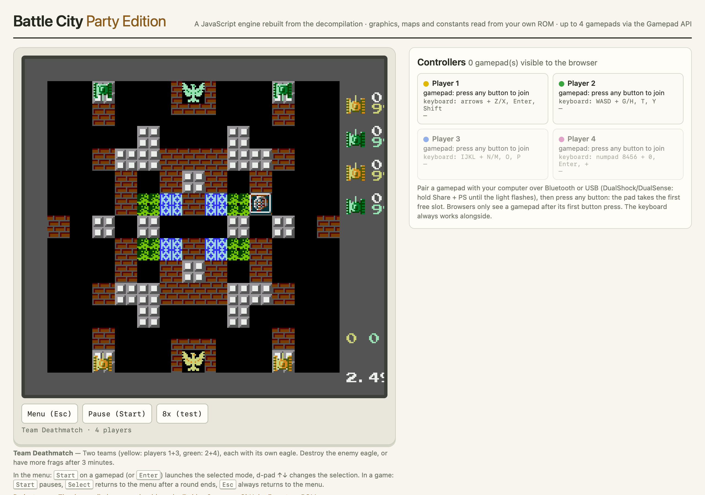
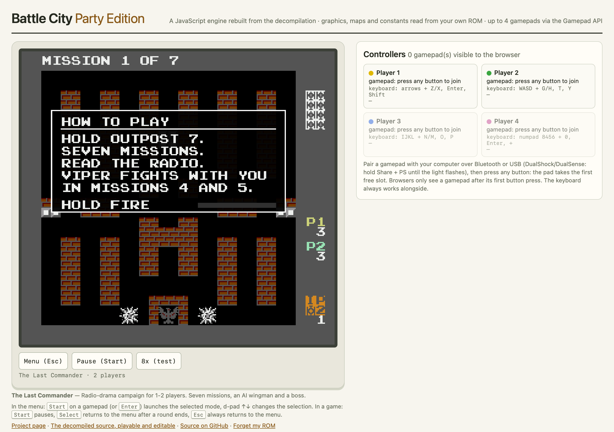
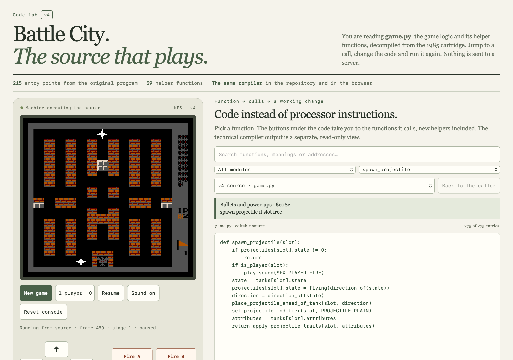
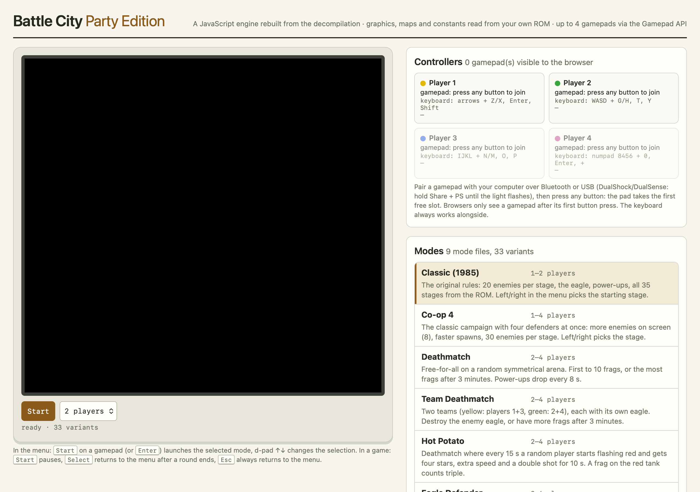

# Battle City, decompiled

Namco's *Battle City* (NES/Famicom, 1985), taken apart two ways:

- **The source that plays** (`decomp/`): the cartridge's 6502 program decompiled into `game.py`, a readable, executable Python-like language. A dedicated compiler turns it into a program that runs inside a NES emulator in place of the original machine code. You can read it function by function, edit a function, recompile it in your browser and play the result.
- **Party Edition** (`party/`): a separate JavaScript engine built from what the decompilation revealed, for up to four players on keyboard and gamepads, with 33 modes: the classic campaign, co-op, deathmatch and team modes, five story campaigns and three two-player duos.

**Play it:** https://battle-city.kolinko.eu/ · [Party Edition](https://battle-city.kolinko.eu/party/) · [Source editor](https://battle-city.kolinko.eu/decomp/)

| Party Edition: 4-player Team Deathmatch | Party Edition: a story campaign briefing |
|---|---|
|  |  |
| **Source editor: the game running from `game.py`** | **Party Edition: the mode menu** |
|  |  |

## Bring your own ROM

This repository and the website contain **none of the original game's data**: no ROM, no graphics, no maps, no tables extracted from it. Both pages ask for your own copy of the Battle City ROM the first time you open them:

- an iNES file of exactly 24,592 bytes (16-byte header, 16 KB program, 8 KB graphics),
- SHA-256 `463c6b44bf03c9bfc8c5d7995354f35ff6a8b23f8292bc558cf71c991870042e`.

The file is checked against that fingerprint, kept in your browser's IndexedDB so you are asked only once, and never uploaded. Any other file (other dumps, hacks, translations) is rejected with a message saying why. *Forget my ROM* at the bottom of each page removes it.

Everything the games need is derived from your ROM at load time. The Party Edition reads the graphics, the 35 stage maps, the enemy rosters, palettes and score values with `party/rom-assets.js` (a port of the original offline extraction script; its output is identical field by field, plus the background palette table). The source editor hands your ROM to the emulator, which supplies graphics and data while the decompiled source supplies the program.

## How to play

**Party Edition** ([`party/`](party/)): pick a mode in the list, choose the number of players and press *Start* (or Start/Enter). Keyboard sets, used alongside gamepads:

| player | move | fire | start | select |
|---|---|---|---|---|
| 1 | arrows | Z / X | Enter | Shift |
| 2 | W A S D | G / H | T | Y |
| 3 | I J K L | N / M | O | P |
| 4 | numpad 8 4 5 6 | numpad 0 / . | numpad Enter | numpad + |

Gamepads: pair a pad with your computer (Bluetooth or USB) and press any button; it takes the first free slot. Browsers only see a gamepad after its first button press. Pads without a standard mapping can be taught with *learn mapping*. In a game, Start pauses, Select returns to the menu after a round, Esc always returns to the menu. Classic and Co-op 4 let you choose the starting stage with left/right in the menu.

**Source editor** ([`decomp/`](decomp/)): *New game* starts the original game (1 or 2 players). Player 1 uses the arrows, Z/X, Enter and Shift; player 2 W/A/S/D and G/H; there is an on-screen pad for touch screens. On the right, pick a function from `game.py`, follow the buttons to the functions it calls, edit, and press *Apply and restart*. The first compile loads a local Python runtime (Pyodide, about 12 MB). See [`decomp/GUIDE.md`](decomp/GUIDE.md).

## How the decompilation works

Be clear about what `game.py` is:

- It is a constrained, Python-style language recovered from the cartridge's machine code. It is **not** CPython, and it is **not** Namco's original source code, which was never published.
- [`decomp/bpyc.py`](decomp/bpyc.py) compiles `game.py` together with [`decomp/game.machine.json`](decomp/game.machine.json) (the bindings that preserve the original timing and hardware entry points) into `game.bpy`.
- [`decomp/source-runtime.js`](decomp/source-runtime.js) runs `game.bpy` inside the [jsnes](https://github.com/bfirsh/jsnes) emulator instead of the original 6502 code. jsnes still emulates the video and sound hardware.
- The result was checked against the real ROM in recorded scenarios, frame by frame and pixel by pixel, under the pinned jsnes model. That is evidence about those scenarios and that emulator, not a proof about every input or a physical NES. The evidence archive from that work is not in this repository, because it embeds ROM data.
- Video, sound and data-encoding drivers are kept visibly technical; the game logic reads as code.
- The browser editor runs the same `bpyc.py` through a bundled [Pyodide](https://pyodide.org), so editing works without any server or CDN.

The **Party Edition** is not the decompiled program. It is a new, hand-written engine (`party/engine.js` plus modes in `party/modes/`) whose classic rules were measured against the ROM: spawn timing, enemy AI, scoring, the shovel and the eagle's ring, and the rest listed in [`party/MODES.md`](party/MODES.md). It renders with the original tiles and stages, read from your ROM. That separate engine is what allows four players; the original game only knows two.

## Running it locally

Any static web server works, as long as it serves over HTTP (browsers only allow the SHA-256 check and Pyodide on `http://localhost` or HTTPS):

```
git clone https://github.com/kolinko/battle-city-party
cd battle-city-party
python3 -m http.server 8000
```

then open <http://localhost:8000/>.

To rebuild the source editor after changing `decomp/game.py`, run `python3 decomp/build.py` (Python 3.14 tested), or `python3 decomp/start.py`, which builds and then serves the repository.

## Tests

The Party Edition has a headless runner and a rule-level scenario suite. Both read game data from your own ROM, which you put at `rom/battle-city.nes` (the `rom/` folder is git-ignored):

```
node tools/headless.js      # every mode, bots for 3600 frames, fails on any exception
node tools/scenario.js      # 55 scenarios asserting the classic rules measured on the ROM
```

## Repository layout

```
index.html            landing page
shared/rom.js         the bring-your-own-ROM gate (SHA-256 check, IndexedDB cache)
party/                Party Edition: engine, renderer, input, modes, rom-assets.js
decomp/               decompiled source, compiler, interpreter, editor
  vendor/jsnes/       the emulator (Apache 2.0)
  pyodide-core/       Python in the browser, for the compiler (MPL 2.0)
tools/                headless runner and scenarios
```

## Licence and disclaimer

The project's own code is under the [MIT licence](LICENSE). Third-party code keeps its own licence: jsnes (Apache License 2.0, [`decomp/vendor/jsnes/LICENSE`](decomp/vendor/jsnes/LICENSE)) and Pyodide (Mozilla Public License 2.0, [`decomp/pyodide-core/pyodide/LICENSE`](decomp/pyodide-core/pyodide/LICENSE)).

This is a fan project, made for study and fun. It is not affiliated with, endorsed by or connected to Bandai Namco Entertainment. *Battle City* and its graphics, maps and program are © 1985 Namco. No part of the original ROM is distributed in this repository or on its website; you need your own copy.
